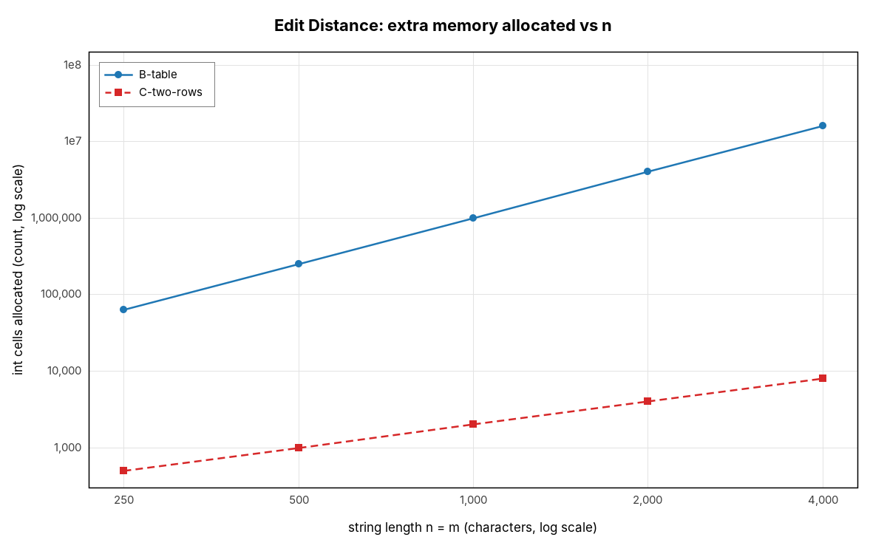
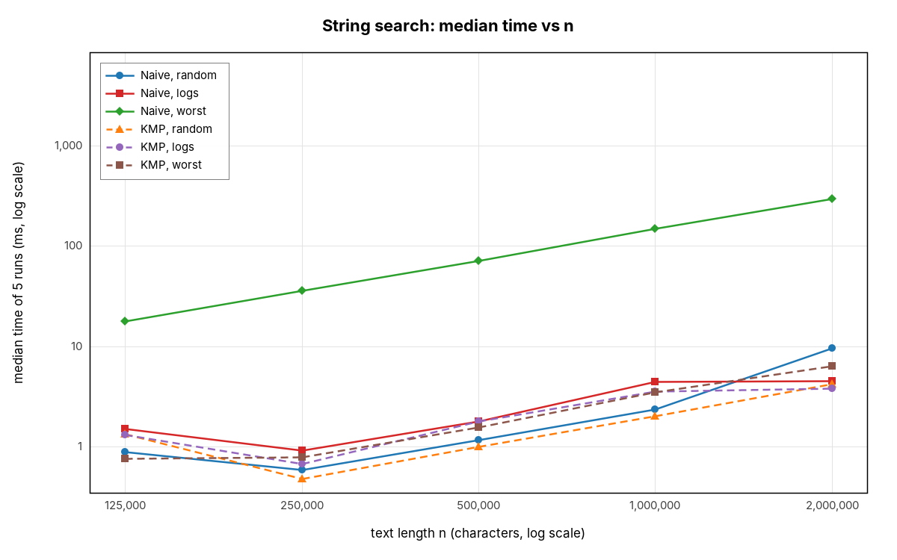

# Assignment 4 — Edit Distance and String Search

**Yersaiyn Taubay, SE-2524**

## 1. Experiment Design Card

*Written before the first run of the full experiment (see the git history: this card was committed before `results/results.csv` existed).*

| Card field | What I plan |
|---|---|
| **Question** | **Edit Distance:** does the recursive version really grow exponentially while the table and two-row versions grow as n·m, and does the two-row version save memory without costing time? **String search:** how many character comparisons per text character do Naive and KMP make, and what input makes Naive lose to KMP? |
| **Sizes (n)** | **ED-A recursive:** n = m = 3, 6, 8, 10, 11, 12 (12 is 4× 3). Past 12 the worst case takes many seconds per run, so 12 is the safe top. **ED-B/C:** n = m = 250, 500, 1000, 2000, 4000 (16×). 4000 gives a 16 M-cell table (64 MB), big enough to time and still safe for the default heap. **Search:** n = 125 000, 250 000, 500 000, 1 000 000, 2 000 000 (16×), large enough that times are in milliseconds, not 0. Extra series for search: n fixed at 200 000, pattern length m = 10, 40, 160, 640 (64×). |
| **Inputs** | **ED identical** (a = b): best case for recursion — every step matches, so only one call per level. **ED typo** (b = a with ~10 % random replacements): the real "Abylai Han" situation. **ED disjoint** (a uses a–m, b uses n–z, no common character): worst case for recursion — every call branches 3 ways. **Search random** (random lowercase text, random pattern of length 10): mismatches come after ~1 character, average case. **Search logs** (generated log lines, pattern `ERROR 503 /api/streets`): the operators' real task, rare matches. **Search worst** (text `A…A`, pattern `A…AB`, m = 100): Naive matches m−1 characters at every position before failing — worst case for Naive. **worst-vary-m**: same worst input with growing m, to separate the effect of m from n. All inputs come from `InputGenerator` with fixed seed 20261112. |
| **Metrics** | `subproblems` — number of d(i,j) evaluations (recursive calls for A, cells written for B/C): this is the unit of DP work. `char_comparisons` — character comparisons; the basic cost of both families. `preprocess_comparisons` — KMP comparisons spent building LPS, so preprocessing cost is visible. `memory_cells` — int cells allocated (table vs two rows vs LPS), to measure the memory trade-off instead of guessing. `alignments` — positions of the pattern tried. `time_ms` — wall-clock time, 5 runs after 1 warm-up run, median used. `result` — distance / number of matches, to cross-check versions inside the experiment. |
| **Prediction** | **ED-A:** on disjoint input calls grow by roughly ×5–6 per +1 in n (a straight line on a log-y plot); on identical input calls = n+1 (linear); typo in between but still exponential. **ED-B/C:** subproblems = (n+1)(m+1) for every input; time ∝ n² (slope 2 on log-log), lines for all inputs almost on top of each other. Two rows: memory 2(m+1) instead of (n+1)(m+1) — at n = 4000 about 2000× less — and about the same time, maybe slightly faster thanks to cache. **Search:** Naive on random and logs ≈ 1.0–1.1 comparisons per character; KMP ≈ 1 too, so on normal text there is little difference and Naive may even be faster in ms (simpler loop). On the worst input Naive makes ≈ m = 100 comparisons per character and KMP ≤ 2. Naive comparisons grow as n·m, KMP as n + m. |
| **Plots** | (1) Recursive calls vs n, log y — is the recursion exponential, and how much does the input matter? (2) Table vs two rows, time vs n, log-log — is it n² and are B and C equally fast? (3) Memory cells vs n, log-log — how much does two rows save? (4) Comparisons per text character vs n (ratio) — which algorithm wastes work on which input? (5) Worst input, comparisons vs m, log-log — is Naive n·m and KMP independent of m? (6) Search time vs n, log-log — do the clock results agree with the counters? |

**Changes to the card after it was written:** none to sizes, inputs, metrics or plots. After the main run I added one separate probe (recursive version, disjoint input, n = 13 and 14, one run each, not in `results.csv`) only to answer the short question about the recursion limit.

**How to reproduce:** `mvn compile exec:java` (seed 20261112, 5 measured runs + 1 warm-up per configuration). Counters are deterministic: two full runs gave identical counter columns in all 430 rows; only `time_ms` changes between runs.

## 2. Plots and Results

All numbers below are medians of 5 runs from `results/summary.csv` (one row per configuration); the raw rows are in `results/results.csv`.

### Plot 1 — recursive Edit Distance

*Takeaway: on disjoint strings the number of calls is a straight line on a log scale (×5.6 per extra character, 377 million calls at n = 12), while on identical strings it is only n + 1.*

### Plot 2 — table vs two rows, time

*Takeaway: all six lines rise with slope ≈ 2 on log-log axes (16× larger n → about 250× more time), and the input type barely matters because both versions always fill every cell.*

### Plot 3 — table vs two rows, memory

*Takeaway: the table grows as n² (16 million cells at n = 4000) while two rows grow as n (8 002 cells), a 2000× difference at the largest size.*

### Plot 4 — comparisons per text character (ratio)

*Takeaway: on random text and logs both algorithms make about 1 comparison per character, but on the worst input Naive makes 100 (= m) and KMP stays at 2.*

### Plot 5 — worst input, growing pattern

*Takeaway: with n fixed, Naive comparisons grow linearly with m (2.0 M → 127.6 M) while KMP stays flat at ≈ 2n = 400 000.*

### Plot 6 — string search time

*Takeaway: the clock agrees with the counters — Naive on the worst input is 20–50× slower than everything else, and all other lines are close together and grow linearly.*

## 3. Prediction vs Result

**Edit Distance.**
*Expected:* recursion exponential on disjoint input (×5–6 per step), linear on identical input; B and C exactly (n+1)(m+1) subproblems and time ∝ n²; C uses far less memory at about the same speed.
*Saw:* the disjoint calls grow ×5.56, ×5.59, ×5.60, ×5.62 from n = 10 to 14 — a confirmed exponential. Identical input needs exactly n + 1 calls. B and C wrote exactly (n+1)(m+1) cells for every input (e.g. 16 008 001 at n = 4000), and going from n = 250 to 4000 multiplied the time by ≈ 247 (table) and ≈ 276 (two rows), close to the predicted 16² = 256. Two rows used 8 002 cells instead of 16 008 001 and was even 15–30 % faster at n = 4000 (56–60 ms vs 69–84 ms).
*Surprise:* the **typo** input is not monotonic for the recursion (Plot 1: 457 calls at n = 6, 127 at n = 8, 8 333 at n = 10, only 19 at n = 11). The reason is that the recursion works from the last characters: while the last characters match it only walks the diagonal, and it starts branching 3 ways only at the typo. So the cost is exponential in the *position of the typo*, not in n. In my seeded inputs the typo is at index 1 for n = 11 (19 calls) but at index 6 for n = 10 (8 333 calls). A typo near the beginning of a long word is cheap, a typo near the end is expensive. Random inputs would hide this, which is why the worst-case input matters.

**String search.**
*Expected:* ≈ 1–1.1 comparisons per character on random and log text for both; on the worst input Naive ≈ m and KMP ≤ 2; Naive cost ∝ n·m, KMP ∝ n + m; maybe Naive slightly faster in ms on normal text because its loop is simpler.
*Saw:* random text — Naive 1.04, KMP 1.04 comparisons per character; logs — Naive 1.11, KMP 1.02 (after every full or partial match of `ERROR 503 /api/streets`, Naive moves one position to the right and reads the same characters again, while KMP continues from where it stopped). Worst input — Naive 99.9–100.0, KMP 2.000 at every n. With n fixed at 200 000, Naive grew 2.0 M → 8.0 M → 32.0 M → 127.6 M as m grew 10 → 640, while KMP stayed at 400 008 – 400 638 (≈ 2n + m). All match the theory.
*Difference:* my guess that Naive could be faster in ms on normal text was not confirmed. KMP was equal or slightly faster at the larger sizes (2 M random: 9.6 ms vs 4.3 ms; 2 M logs: 4.5 ms vs 3.8 ms). Both make almost the same number of comparisons there, the JIT compiles both loops well, and KMP reads each text character once in order, so it loses nothing to its extra `lps` lookups. At the small sizes (125 000) the order is sometimes reversed, but those times are around 1 ms and are mostly noise.

## 4. Short Answers

**Which input made your string search slowest, and why?**
The worst input — text `AAAA…A` and pattern `AA…AB` — made Naive the slowest by far: 296 ms at n = 2 000 000 compared with 6.4 ms for KMP on the same input. At every start position Naive matches the 99 `A`s, fails on the `B`, then moves one position to the right and compares the same 99 `A`s again, so it does about (n − m + 1)·m ≈ 2·10⁸ comparisons. KMP on the same input uses lps of the pattern (which tells it that after a mismatch the last 98 `A`s already match) and never moves back in the text, so it does at most 2n comparisons. For KMP the "worst" input was also its slowest, but only because it makes 2 comparisons per character instead of about 1.

**How large an n could the recursive Edit Distance handle, and what stopped it?**
On the worst (disjoint) input the recursion handled n = m = 12 in about 0.8 s (377 M calls). The separate probe gave 4.3 s for n = 13 (2.1 billion calls) and 21.7 s for n = 14 (11.9 billion calls), so every extra character costs ×5.6; n = 15 would take about 2 minutes, n = 16 about 11 minutes and n = 17 about an hour. What stopped it was time, not memory: the recursion depth is at most n + m, so the stack never overflows, but the same subproblems d(i, j) are recomputed billions of times. On identical strings the same code handles any n easily (n + 1 calls), so the limit depends on the input.

**What do you gain and what do you lose with two rows instead of the full table?**
I gain memory: 2(m + 1) cells instead of (n + 1)(m + 1), measured as 8 002 vs 16 008 001 cells (64 MB less) at n = 4000, so much longer strings fit in memory. The number of subproblems and comparisons stays exactly the same, and in my runs two rows was even 15–30 % faster, probably because two small arrays stay in the CPU cache. What I lose is the history: with only the last two rows I cannot walk back through the table to recover *which* edits (insert, delete, replace) produce the distance, so the method can only return the number. If the city platform wanted to show "did you mean…" with highlighted changes, I would need the full table (or a smarter method such as Hirschberg's).

**If you had to choose one string search for the city platform, which one and why?**
I would choose KMP. On normal log text it was as fast as Naive or a little faster (about 1.02 comparisons per character on the logs), so there is no price for using it. Its cost is guaranteed to be at most about 2n + m, while Naive can suddenly become m times slower on repetitive input — and logs are repetitive by nature (long runs of the same characters, the same line prefixes again and again). KMP also never moves back in the text, so it can read a huge log file as a stream in one pass without keeping old parts in memory.

## 5. One Paragraph on Time

The measured times were noisy at the small end and clean at the large end. For the recursion on identical strings every run took about 1 µs, which is the resolution of the timer, so the clock shows almost nothing there, and below about 1 ms the median sometimes went *down* when n doubled (e.g. Naive random 0.90 ms at 125 000 and 0.59 ms at 250 000) because of JIT compilation, garbage collection and other processes on the machine. Above ~5 ms the times followed the theory well (n² for the DP, linear for the searches). This is why the clock is not my only evidence: time depends on the laptop, the JVM and the order of runs, and two full runs gave different times, but the counters (subproblems, comparisons, memory cells) were identical in every row of both runs and are exactly what the formulas predict. I used the median of 5 runs after a warm-up run to reduce noise, and I base every conclusion on a counter first and use time only to check that the counters describe real cost.
