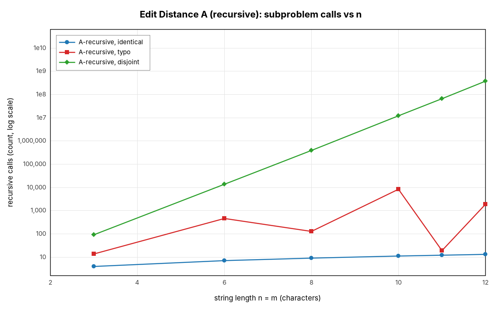
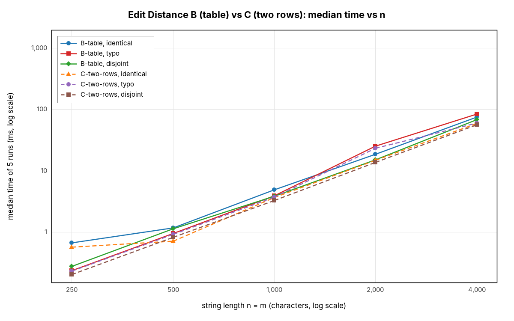
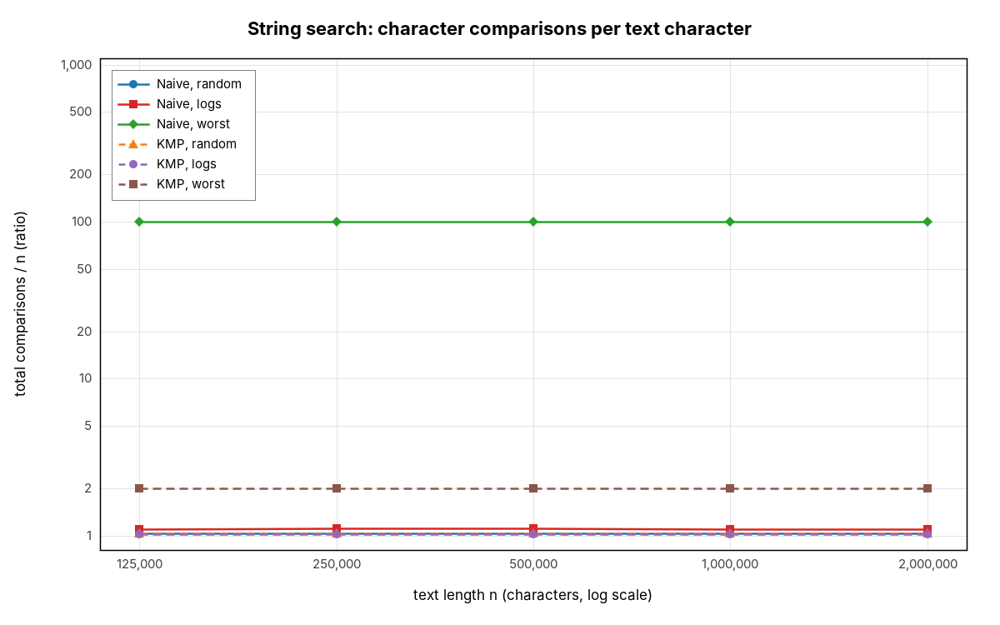
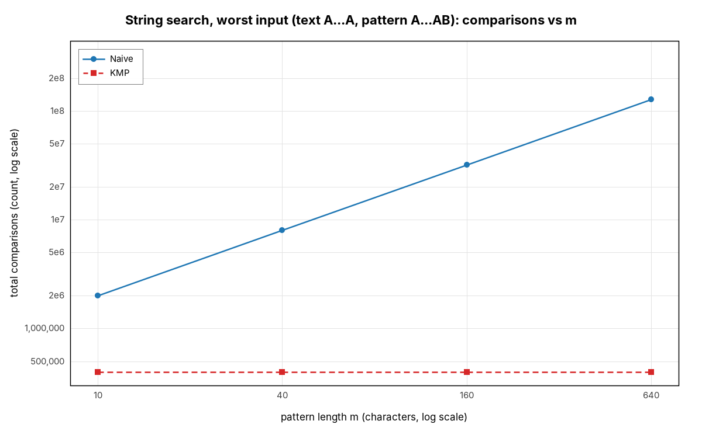

# Assignment 4 — Edit Distance and String Search

**Yersaiyn Taubay, SE-2524**

## 1. Experiment Design Card

*Written before the first run of the full experiment (see the git history: this card was committed before `results/results.csv` existed).*

| Card field | What I plan |
|---|---|
| **Question** | **Edit Distance:** does the recursive version really grow exponentially while the table and two-row versions grow as n·m, and does the two-row version save memory without costing time? **String search:** how many character comparisons per text character do Naive and KMP make, and what input makes Naive lose to KMP? |
| **Sizes (n)** | **ED-A recursive:** n = m = 3, 6, 8, 10, 11, 12 (12 is 4× 3). Past 12 the worst case takes many seconds per run, so 12 is the safe top. **ED-B/C:** n = m = 250, 500, 1000, 2000, 4000 (16×). 4000 gives a 16 M-cell table (64 MB), big enough to time and still safe for the default heap. **Search:** n = 125 000, 250 000, 500 000, 1 000 000, 2 000 000 (16×), large enough that times are in milliseconds, not 0. Extra series for search: n fixed at 200 000, pattern length m = 10, 40, 160, 640 (64×). |
| **Inputs** | **ED identical** (a = b): best case for recursion — every step matches, so only one call per level. **ED typo** (b = a with ~10 % random replacements): the real "Abylai Han" situation. **ED disjoint** (a uses a–m, b uses n–z, no common character): worst case for recursion — every call branches 3 ways. **Search random** (random lowercase text, random pattern of length 10): mismatches come after ~1 character, average case. **Search logs** (generated log lines, pattern `ERROR 503 /api/streets`): the operators' real task, rare matches. **Search worst** (text `A…A`, pattern `A…AB`, m = 100): Naive matches m−1 characters at every position before failing — worst case for Naive. **worst-vary-m**: same worst input with growing m, to separate the effect of m from n. All inputs come from `InputGenerator` with fixed seed 20261112. |
| **Metrics** | `subproblems` — number of d(i,j) evaluations (recursive calls for A, cells written for B/C): this is the unit of DP work. `char_comparisons` — character comparisons; the basic cost of both families. `preprocess_comparisons` — KMP comparisons spent building LPS, so preprocessing cost is visible. `memory_cells` — int cells allocated (table vs two rows vs LPS), to measure the memory trade-off instead of guessing. `alignments` — positions of the pattern tried. `time_ms` — wall-clock time, 5 runs after 1 warm-up run, median used. `result` — distance / number of matches, to cross-check versions inside the experiment. |
| **Prediction** | **ED-A:** on disjoint input calls grow by roughly ×5–6 per +1 in n (a straight line on a log-y plot); on identical input calls = n+1 (linear); typo in between but still exponential. **ED-B/C:** subproblems = (n+1)(m+1) for every input; time ∝ n² (slope 2 on log-log), lines for all inputs almost on top of each other. Two rows: memory 2(m+1) instead of (n+1)(m+1) — at n = 4000 about 2000× less — and about the same time, maybe slightly faster thanks to cache. **Search:** Naive on random and logs ≈ 1.0–1.1 comparisons per character; KMP ≈ 1 too, so on normal text there is little difference and Naive may even be faster in ms (simpler loop). On the worst input Naive makes ≈ m = 100 comparisons per character and KMP ≤ 2. Naive comparisons grow as n·m, KMP as n + m. |
| **Plots** | (1) Recursive calls vs n, log y — is the recursion exponential, and how much does the input matter? (2) Table vs two rows, time vs n, log-log — is it n² and are B and C equally fast? (3) Memory cells vs n, log-log — how much does two rows save? (4) Comparisons per text character vs n (ratio) — which algorithm wastes work on which input? (5) Worst input, comparisons vs m, log-log — is Naive n·m and KMP independent of m? (6) Search time vs n, log-log — do the clock results agree with the counters? |

**Changes to the card after it was written:** none to sizes, inputs, metrics or plots. After the main run I added one separate probe (recursive version, disjoint input, n = 13 and 14, one run each, not in `results.csv`) only to answer the short question about the recursion limit.

**How to reproduce:** `mvn compile exec:java` (seed 20261112, 5 runs + 1 warm-up per configuration). Two full runs gave identical counters in all 430 rows; only `time_ms` changed.

## 2. Plots and Results

Medians of 5 runs from `results/summary.csv`; raw rows in `results/results.csv`. Two more plots are in `results/plots/` (3: memory, 6: search time); their numbers are given in the text.

 

*Plot 1. On disjoint strings the calls form a straight line on the log scale (×5.6 per extra character, 377 M calls at n = 12); on identical strings there are only n + 1.*  
*Plot 2. All lines have slope ≈ 2 on log-log axes (16× larger n → ≈ 250× more time), and the input type barely matters because every cell is always filled.*

 

*Plot 4. On random text and logs both algorithms make ≈ 1 comparison per character; on the worst input Naive makes 100 (= m) and KMP stays at 2.*  
*Plot 5. With n fixed at 200 000, Naive comparisons grow linearly with m (2.0 M → 127.6 M) while KMP stays flat at ≈ 2n.*

## 3. Prediction vs Result

**Edit Distance.** *Expected:* exponential recursion on disjoint input, n + 1 calls on identical input, (n+1)(m+1) cells and n² time for B and C, far less memory for C at about the same speed. *Saw:* disjoint calls grow ×5.56–5.62 per step (n = 10…14); identical input takes exactly n + 1 calls; B and C wrote exactly (n+1)(m+1) cells on every input, and n = 250 → 4000 multiplied time by ≈ 247 (B) and ≈ 276 (C) against the predicted 256. C used 8 002 cells instead of 16 008 001 (plot 3) and was even 15–30 % faster at n = 4000. *Surprise:* the recursion on **typo** input is not monotonic (457 calls at n = 6, 127 at n = 8, 8 333 at n = 10, 19 at n = 11). The recursion starts from the last characters and only walks the diagonal while they match, so it branches only from the typo backwards: the cost is exponential in the *number of characters before the typo*, not in n (the typo is at index 1 for n = 11 and at index 6 for n = 10).

**String search.** *Expected:* ≈ 1–1.1 comparisons per character on random and log text, ≈ m for Naive and ≤ 2 for KMP on the worst input, maybe Naive slightly faster in ms on normal text. *Saw:* random 1.04 vs 1.04, logs 1.11 vs 1.02 (after every match of the error line Naive re-reads the same characters), worst 100 vs 2.000, and Naive ∝ m in plot 5 — all as predicted. *Difference:* Naive was not faster on normal text; KMP was equal or slightly faster at large n (2 M random: 9.6 vs 4.3 ms; logs: 4.5 vs 3.8 ms), because both make almost the same comparisons and KMP reads the text once, in order. Below ~1 ms the order sometimes flips, which is noise.

## 4. Short Answers

**Slowest input for string search.** The worst input (text `A…A`, pattern `A…AB`, m = 100) made Naive slowest: 296 ms at n = 2 000 000 against 6.4 ms for KMP (plot 6). At every position Naive matches 99 `A`s, fails on `B`, shifts by one and compares the same `A`s again, ≈ (n − m + 1)·m = 2·10⁸ comparisons. KMP knows from lps that the last 98 `A`s still match and never moves back in the text, so it needs at most 2n comparisons.

**Limit of the recursive Edit Distance.** On disjoint strings it handled n = 12 in 0.8 s; a separate probe took 4.3 s for n = 13 and 21.7 s for n = 14. Each extra character costs ×5.6, so n = 16 would take ≈ 11 min and n = 17 ≈ 1 h. Time stopped it, not memory: the depth is only n + m, but the same d(i, j) is recomputed billions of times. On identical strings any n works (n + 1 calls).

**Two rows vs full table.** I gain memory: 2(m + 1) instead of (n + 1)(m + 1) cells, 8 002 vs 16 008 001 at n = 4000 (64 MB less), with the same number of subproblems and even slightly less time. I lose the history: without the full table I cannot walk back to find *which* insertions, deletions and replacements give the distance. A "did you mean…" feature that highlights the changes would need the table (or Hirschberg's method).

**String search for the city platform.** KMP. On real log text it is as fast as Naive or faster, so it costs nothing, and its cost is guaranteed to be ≈ 2n + m. Naive can suddenly become m times slower on repetitive text, and logs are repetitive. KMP also never moves back in the text, so a huge log can be read as a stream in one pass.

## 5. One Paragraph on Time

Times were noisy at the small end and clean at the large end: identical-string recursion took ≈ 1 µs (the timer's resolution), and below ~1 ms the median sometimes went *down* when n doubled (Naive random: 0.90 ms at 125 000, 0.59 ms at 250 000) because of JIT compilation, garbage collection and other processes. Above ~5 ms the times followed the theory (n² for the DP, linear for search). Time depends on the laptop, the JVM and run order, and it differed between my two full runs, while every counter was identical in both and matched the formulas exactly. So I used the median of 5 runs after a warm-up, but based each conclusion on a counter first and used time only to confirm that the counters describe real cost.
